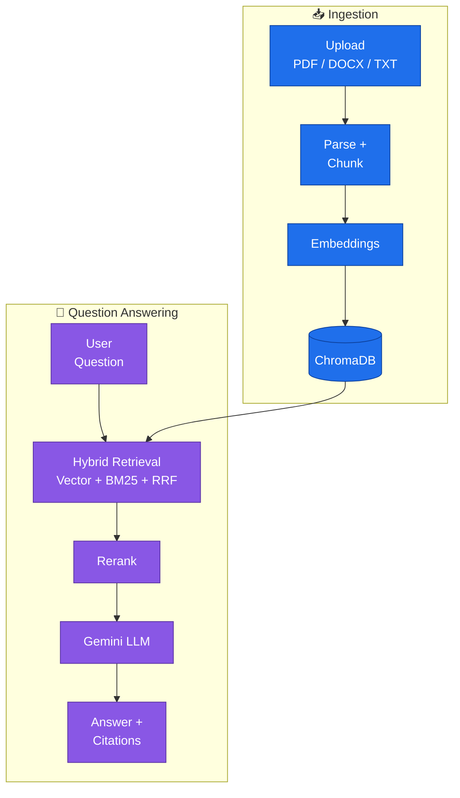
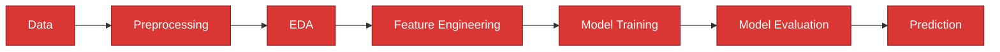
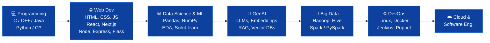

<!-- ===================== HEADER ===================== -->
<div align="center">


<a href="https://github.com/Roygautam8852">
  
</a>

<br/>


<br/><br/>

<a href="https://www.linkedin.com/in/gautam-kumar-roy/"></a>
<a href="mailto:gautamkumar@gmail.com"></a>
<a href="https://leetcode.com/u/gautamkumar80004/"></a>
<a href="https://codolio.com/profile/gautamkumar8252"></a>
<a href="https://endearing-lolly-094b15.netlify.app/"></a>

</div>


## 👨‍💻 About Me

I'm **Gautam Kumar**, a **B.Tech Computer Science and Engineering** student at **Lovely Professional University (LPU)**, with **Data Science** as my major and **DevOps** as my minor.

I have also learned the **MERN Stack** through my **PEP program** and have built projects across **Web Development, Data Science, Machine Learning, Generative AI, Data Analytics, Power BI, Big Data, DevOps, Cloud Deployment, Backend Development, and DSA**. I keep experimenting, learning, and building practical projects on GitHub.

```js
const gautam = {
  role: "B.Tech CSE Student @ Lovely Professional University",
  major: "Data Science",
  minor: "DevOps",
  focus: ["Machine Learning", "GenAI / RAG", "Full Stack (MERN)", "DevOps", "Big Data"],
  currentlyBuilding: "DocuMind: RAG-based document intelligence",
  problemsSolved: "520+ across LeetCode, GFG, CodeChef, Codeforces",
  goal: "Build production-grade AI + Data products"
};
```

> [!TIP]
> 🔥 **Currently building:** [DocuMind](https://github.com/Roygautam8852/Documind-), a RAG app with hybrid retrieval (vector search + BM25), reranking and citation-grounded answers.

<div align="center">

| 🎓 Degree | 🏫 University | 📊 Major | ⚙️ Minor | 📈 CGPA |
|:---:|:---:|:---:|:---:|:---:|
| B.Tech CSE | Lovely Professional University | Data Science | DevOps | 8.03 |

</div>


## 🛠️ Technical Skills

### 💻 Programming Languages

<p>
  
  
</p>

### 🌐 Web Development

| Layer | Technologies |
|---|---|
| **Frontend** |   |
| **Backend** |   |
| **Database** |   |
| **Full Stack** | **MERN Stack:**  |

### 📊 Data Science & Machine Learning


**Core skills:**


### 🤖 Generative AI & LLMs <sub>`NEW`</sub>


### 🐘 Big Data


`HDFS` • `YARN` • `MapReduce` • `Sqoop` • `Flume` • `Pig` • `Data Processing`

### ⚙️ DevOps & Cloud

<p>
  
</p>


### 📈 Data Analytics & Business Intelligence


`Dashboard Development` • `Data Visualization` • `Data Analysis` • `Star Schema` • `KPIs`


## 🚀 Featured Projects

<table>
<tr>
<td width="50%" valign="top">

### 📄 DocuMind <sub>`NEW`</sub>
**RAG-based Document Intelligence System**

Upload PDF, DOCX or TXT files, then search, chat with and summarize them. Uses **hybrid retrieval** (vector search + BM25 fused with RRF), optional **cross-encoder reranking** and **citation validation**. If the evidence is weak, it says so instead of guessing. Can also compare 2 to 10 documents.


[](https://github.com/Roygautam8852/Documind-)

</td>
<td width="50%" valign="top">

### ❤️ Heart Disease Prediction
**End-to-end Machine Learning System**

Predicts heart disease from **10,000+ patient records**. Full pipeline: data cleaning, EDA, feature engineering, then **8 classification models** compared on Accuracy, Precision, Recall, F1, ROC-AUC and 5-fold cross-validation. Served through a **Streamlit app** with a confidence score.


[](https://github.com/Roygautam8852/Heart-Disease-Prediction-System)

</td>
</tr>
<tr>
<td width="50%" valign="top">

### 🌾 Farmer Crop Price Predictor
**AI-powered Price Prediction Platform**

Helps Indian farmers estimate the future **modal market price** and a min–max range for crops like rice, wheat, tomato, onion, potato and maize. A **Random Forest** model (compared with Linear Regression) sits behind a React + Node API, with predictions saved in MongoDB. Ships with **Docker**, **GitHub Actions** CI and **Jenkins** CD.


[](https://github.com/Roygautam8852/Farmer-crop-price-prediction-model)

</td>
<td width="50%" valign="top">

### 📚 Student Record Manager
**Digital School Register & Attendance Platform**

Digitizes traditional school register workflows: **student and class management**, **attendance tracking with analytics**, **marks management**, **charts and visualization**, **student profiles** and **authentication**.


<!-- Add Live Demo link: [](https://YOUR-DEMO-LINK) -->
[](https://github.com/Roygautam8852/Student_Task_Manager)

</td>
</tr>
</table>

### 🧬 How DocuMind works



### ❤️ Heart Disease pipeline



### 📦 More Projects

| Project | What it does | Technology | Link |
|---|---|---|---|
| 📊 **Samsung Supply Chain & Logistics Dashboard** | Power BI dashboard on supply chain, inventory, shipments and customers. Built with a Star Schema and DAX KPIs, with a supplier page that compares 7 suppliers on cost, quality and delivery time. | `Power BI` `DAX` `Data Modeling` | [Repo](https://github.com/Roygautam8852?tab=repositories&q=samsung) |
| 🚗 **Car Sales Analysis & Prediction** | End-to-end ML project on 23,000+ car sales records: cleaning, EDA, KPI analysis, IQR outlier removal (~800 rows), one-hot encoding and a Random Forest price model (R² ≈ 0.65). | `Python` `Pandas` `Scikit-learn` `Jupyter` | [Repo](https://github.com/Roygautam8852?tab=repositories&q=car) |
| ⚡ **Electricity Fault Detection** | Detects electricity-related faults using software and data-driven techniques. | `JavaScript` | [Repo](https://github.com/Roygautam8852?tab=repositories&q=electricity) |
| 🇮🇳 **India Crime Analytics & Prediction System** | Data-driven analytics and prediction project focused on crime-related information. | `JavaScript` | [Repo](https://github.com/Roygautam8852?tab=repositories&q=crime) |
| 🏆 **Hackethon Management System** | Web-based system for managing hackathon activities and workflows. | `JavaScript` | [Repo](https://github.com/Roygautam8852?tab=repositories&q=hack) |
| 🏥 **Hospital Appointment System** | Web application for managing hospital appointment workflows. | `JavaScript` | [Repo](https://github.com/Roygautam8852/Hospital-Appointment-System) |
| 🔄 **SyncSpace** | Web application focused on collaborative and interactive functionality. | `JavaScript` | [Repo](https://github.com/Roygautam8852?tab=repositories&q=syncspace) |
| 🐳 **Docker Class Work** | Hands-on DevOps practice with containers: Docker concepts and workflows. | `Docker` | [Repo](https://github.com/Roygautam8852/Docker-class-work) |
| ⚙️ **GitHub Jenkins** | Hands-on integration of GitHub and Jenkins with CI/CD concepts. | `Jenkins` `GitHub` | [Repo](https://github.com/Roygautam8852/github-jenkins) |

<details>
<summary><b>💻 MERN & Web Development Projects</b> (click to expand)</summary>

<br/>

| Project | Focus |
|---|---|
| 📝 [PEP_Todo](https://github.com/Roygautam8852/PEP_Todo) | React / Frontend |
| ⚛️ [PEP_ReactApp](https://github.com/Roygautam8852/PEP_ReactApp) | React |
| 🌐 [PEP_Portfolio](https://github.com/Roygautam8852/PEP_Portfolio) | Portfolio / Frontend |
| 🔐 [SecretDiary](https://github.com/Roygautam8852/SecretDiary) | Web Application |
| 🛒 [CookCart](https://github.com/Roygautam8852/CookCart) | Web Development |
| 📋 [TodoList](https://github.com/Roygautam8852/TodoList) | Frontend |
| 🎴 [Dynamic-card-practice](https://github.com/Roygautam8852/Dynamic-card-practice) | UI / CSS |
| 🐛 [Issue-Tracker](https://github.com/Roygautam8852/Issue-Tracker) | Web Application |
| 📢 [Complaint-api](https://github.com/Roygautam8852/Complaint-api) | Backend / API |
| 👨‍🎓 [Student-record-api](https://github.com/Roygautam8852/Student-record-api) | Backend / API |
| 🏥 [Hospital-Appointment-System](https://github.com/Roygautam8852/Hospital-Appointment-System) | Web Application |

</details>

<details>
<summary><b>📊 Data & Analytics Projects</b> and <b>🔧 DevOps Projects</b> (click to expand)</summary>

<br/>

**Data & Analytics:** 🚗 Car Sales Analysis & Prediction • ❤️ Heart Disease Prediction System • 🇮🇳 India Crime Analytics & Prediction • 🌾 Farmer Crop Price Prediction • 📦 Samsung Supply Chain & Logistics Dashboard • 🦠 COVID-19 Dashboard • 📊 Insurance Claims Analysis • 🐘 Big Data Classwork • 📄 DocuMind (RAG)

**DevOps:** 🐳 Docker • 🔄 Docker Compose • ⚙️ Jenkins • 🚀 GitHub Actions • 🐧 Linux • 🌐 Nginx • 🎛️ Puppet • 🖥️ VMware • ☁️ Deployment

**Related repositories:** [GitHubActions](https://github.com/Roygautam8852/GitHubActions) • [github-jenkins](https://github.com/Roygautam8852/github-jenkins) • [Docker-class-work](https://github.com/Roygautam8852/Docker-class-work)

</details>


## 🧠 Problem Solving & DSA

<div align="center">


<br/><br/>

<a href="https://leetcode.com/u/gautamkumar80004/">
  
</a>

<br/>


</div>


```text
📊 Top DSA topics
Arrays          ████████████████████ 130
String          ███████              46
HashMap & Set   ██████▌              44
Two Pointers    ██████▌              41
Sorting         ██████               39
Binary Search   █████▌               37
Trees           █████▌               35
Algorithms      █████▌               35
```

### 🏆 LeetCode at a glance

| 🧮 Solved | 🟢 Easy | 🟡 Medium | 🔴 Hard | 📊 Submissions (1 yr) | 📅 Active Days | 🔥 Max Streak | 🏅 Badges |
|:---:|:---:|:---:|:---:|:---:|:---:|:---:|:---:|
| **238** | **111** | **111** | **16** | **521** | **210** | **33 Days** | **2** |


**Topics I practice:** `Arrays` • `Strings` • `Linked Lists` • `Stacks` • `Queues` • `Hashing` • `Heaps` • `Binary Trees` • `BST` • `Graphs` • `BFS` • `DFS` • `Dijkstra` • `Floyd-Warshall` • `Prim` • `Kruskal` • `Dynamic Programming` • `Greedy`


## 🎓 Certifications & Achievements

| Certificate / Achievement | Issuer | When |
|---|---|---|
| 🖥️ Introduction to Operating Systems | IBM (Coursera) | Sep 2024 |
| 🌐 Fundamentals of Computer Network | University of Colorado (Coursera) | Nov 2024 |
| ☁️ Cloud Computing | NPTEL | Apr 2025 |
| 🧮 Mastering Data Structures and Algorithms (Training) | Lovely Professional University | Jun – Jul 2025 |
| 💼 Data Analyst Virtual Internship (Job Simulation) | Deloitte | Mar 2026 |
| 📊 Basics of Data Analytics | Physics Wallah × Microsoft | Jun 2026 |

## 📈 GitHub Statistics

<div align="center">


<br/>


<br/>


<br/><br/>

<!-- Snake animation: needs the snake.yml workflow to have run once -->
<picture>
  <source media="(prefers-color-scheme: dark)" srcset="https://raw.githubusercontent.com/Roygautam8852/Roygautam8852/output/github-snake-dark.svg"/>
  <source media="(prefers-color-scheme: light)" srcset="https://raw.githubusercontent.com/Roygautam8852/Roygautam8852/output/github-snake.svg"/>
  
</picture>

</div>


## 📌 Currently Learning


## 🎯 My Development Interests

📊 Data Science &nbsp;•&nbsp; 🤖 Machine Learning &nbsp;•&nbsp; 🧬 Generative AI &nbsp;•&nbsp; 🌐 Full Stack Development &nbsp;•&nbsp; ⚙️ DevOps & Cloud &nbsp;•&nbsp; 🐘 Big Data &nbsp;•&nbsp; 📈 Data Analytics &nbsp;•&nbsp; 💻 Backend Development &nbsp;•&nbsp; 🧠 Problem Solving &nbsp;•&nbsp; 🏗️ Software Engineering

## 🗺️ My Learning Journey



## 🎯 Goals

- 🚀 Improve DSA and problem-solving
- 📊 Become stronger in Data Science & Machine Learning
- 🤖 Build production-grade GenAI / RAG applications
- ☁️ Build deeper DevOps & Cloud knowledge
- 🐳 Master Docker and CI/CD
- 🏗️ Improve System Design knowledge
- 🌐 Build scalable full-stack applications
- 🐘 Strengthen Big Data skills
- 🤝 Contribute to Open Source
- 💡 Continue building practical projects

## 🤝 Let's Connect

<div align="center">

<a href="https://github.com/Roygautam8852"></a>
<a href="https://www.linkedin.com/in/gautam-kumar-roy/"></a>
<a href="mailto:gautamkumar@gmail.com"></a>
<a href="https://leetcode.com/u/gautamkumar80004/"></a>
<a href="https://codolio.com/profile/gautamkumar8252"></a>
<a href="https://endearing-lolly-094b15.netlify.app/"></a>

<br/><br/>


</div>
