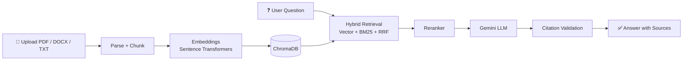
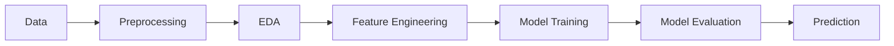
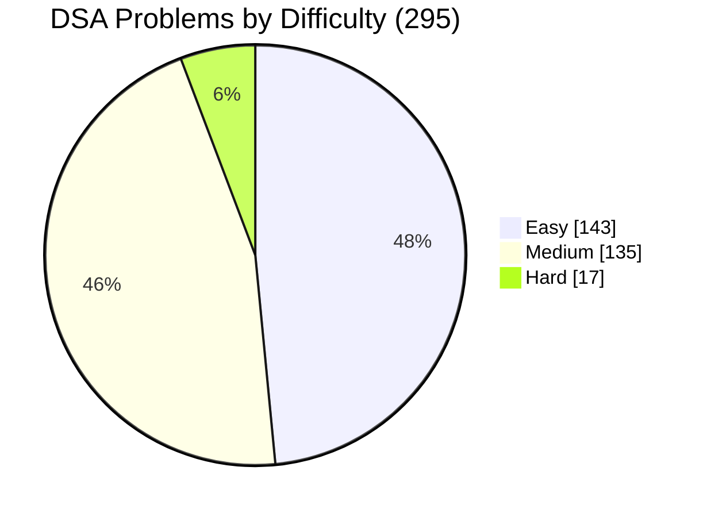
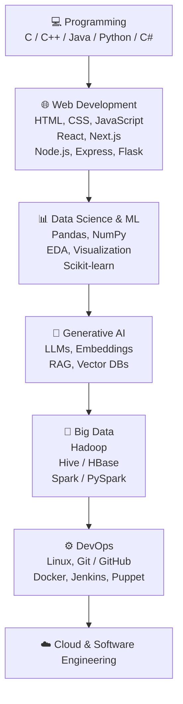

<!-- ===================== HEADER ===================== -->
<div align="center">


<a href="https://github.com/Roygautam8852">
  
</a>

<br/>


</div>


## 👨‍💻 About Me

I'm **Gautam Kumar**, a **B.Tech Computer Science and Engineering** student at **Lovely Professional University (LPU)**.

🎯 **Major:** Data Science &nbsp;&nbsp; ⚙️ **Minor:** DevOps

I have also learned the **MERN Stack** through my **PEP program** and have built projects across **Web Development, Data Science, Machine Learning, Generative AI, Data Analytics, Power BI, Big Data, DevOps, Cloud Deployment, Backend Development, and DSA**.

I keep **experimenting, learning, and building practical projects** on GitHub.

> 🔥 **Currently building:** [DocuMind](https://github.com/Roygautam8852/Documind-), a RAG-based document intelligence app with hybrid retrieval (vector search + BM25), reranking and citation-grounded answers.

### 🔎 Quick Overview

| | | |
|---|---|---|
| 🎓 **Degree** | B.Tech Computer Science & Engineering |  |
| 🏫 **University** | Lovely Professional University |  |
| 📊 **Major** | Data Science | |
| ⚙️ **Minor** | DevOps | |
| 📦 **Public Repositories** |  | |
| ⭐ **GitHub Stars** |  | |
| 👥 **Followers** |  | |
| 👤 **Following** |  | |
| 💻 **Main Focus** | Data Science, GenAI / RAG, Full Stack, DevOps | |


## 🛠️ Technical Skills

### 💻 Programming Languages

<p>
  
  
</p>

### 🌐 Web Development

| Layer | Technologies |
|---|---|
| **Frontend** | <br/>`HTML` • `CSS` • `JavaScript` • `React.js` • `Next.js` • `Tailwind CSS` • `Chart.js` |
| **Backend** | <br/>`Node.js` • `Express.js` • `Flask` • `FastAPI` • `REST APIs` |
| **Database** | <br/>`MongoDB` • `MongoDB Atlas` • `SQL` • `MySQL Concepts` • `PostgreSQL` |
| **Full Stack** | **MERN Stack:** `MongoDB` → `Express.js` → `React.js` → `Node.js` |

### 📊 Data Science & Machine Learning

**Core Skills**


**Libraries & Tools**


### 🤖 Generative AI & LLMs <sub>`NEW`</sub>


### 🐘 Big Data

| Ecosystem | Technologies |
|---|---|
| **Hadoop** | `HDFS` • `YARN` • `MapReduce` • `Hive` • `HBase` • `Sqoop` • `Flume` • `Pig` |
| **Spark** | `Apache Spark` • `PySpark` • `Spark SQL` • `Data Processing` |

### ⚙️ DevOps & Cloud

<p>
  
</p>

| | |
|---|---|
| **Technologies** | `Git` • `GitHub` • `Docker` • `Docker Compose` • `Jenkins CI/CD` • `GitHub Actions` • `Linux` • `Nginx` • `Puppet` • `VMware` |
| **Deployment** | `Netlify` • `Render` |

### 📈 Data Analytics & Business Intelligence


`Power BI` • `DAX` • `Data Visualization` • `Dashboard Development` • `Data Analysis` • `Pandas` • `Matplotlib` • `Seaborn` • `Plotly`


## 🚀 Featured Projects

<div align="center">

<a href="https://github.com/Roygautam8852/Documind-"></a>
<a href="https://github.com/Roygautam8852/Heart-Disease-Prediction-System"></a>
<a href="https://github.com/Roygautam8852/Farmer-crop-price-prediction-model"></a>
<a href="https://github.com/Roygautam8852/Student_Task_Manager"></a>

</div>

### 📄 DocuMind: RAG-based Document Intelligence System <sub>`NEW`</sub>

A self-hostable app to **upload, search, chat with and summarize** PDF, DOCX and TXT files. Answers come with **citations** to the exact source passages, and the system **abstains** when the evidence is weak.



**Highlights:** hybrid search (dense + BM25 with Reciprocal Rank Fusion) • query reformulation for follow-ups • cross-encoder reranking • citation validation • abstention to reduce hallucination • multi-document comparison • JWT auth • Docker Compose

**Technology:** `Python` `FastAPI` `LLMs (Gemini)` `Sentence Transformers` `ChromaDB` `BM25` `PostgreSQL` `React` `TypeScript` `Docker`

🔗 [GitHub Repository](https://github.com/Roygautam8852/Documind-)

---

### ❤️ Heart Disease Prediction System

A structured **Machine Learning** project that predicts heart disease from patient health data (10,000+ records), compares **8 classification models** and serves predictions with a confidence score through a **Streamlit** app.



**Technology:** `Python` `Pandas` `NumPy` `Scikit-learn` `Matplotlib` `Seaborn` `Streamlit` `Jupyter Notebook`

🔗 [GitHub Repository](https://github.com/Roygautam8852/Heart-Disease-Prediction-System)

---

### 🌾 Farmer Crop Price Prediction Model

An **AI-powered crop price prediction platform** for Indian farmers. A **Random Forest** regression model (compared against Linear Regression) predicts the modal market price and an estimated min–max range from crop, state, month, year and season. Predictions are stored in **MongoDB**, and the stack ships with **Docker**, **GitHub Actions** (CI) and **Jenkins** (CD).

**Technology:** `Python` `Scikit-learn` `Random Forest` `React` `Node.js` `Express.js` `MongoDB` `Docker` `Jenkins` `GitHub Actions`

🔗 [GitHub Repository](https://github.com/Roygautam8852/Farmer-crop-price-prediction-model)

---

### 📚 Student Record Manager

A student management and attendance platform designed to **digitize traditional school register workflows**.

| | | | |
|---|---|---|---|
| 👨‍🎓 Student Management | 🏫 Class Management | 🟢 Attendance Tracking | 📊 Attendance Analytics |
| 📝 Marks Management | 📈 Charts & Visualization | 👤 Student Profiles | 🔐 Authentication |

**Technology:** `React` `JavaScript` `Chart.js` `Node.js`

<!-- 🌐 Add your Live Demo link here: [Live Demo](https://your-demo-link) -->
🔗 [Student Task Manager Repository](https://github.com/Roygautam8852/Student_Task_Manager)

---

### 📦 More Projects

| Project | Description | Technology | Link |
|---|---|---|---|
| ⚡ **Electricity Fault Detection** | Detects electricity-related faults using software / data-driven techniques. | `JavaScript` | [Repo](https://github.com/Roygautam8852?tab=repositories&q=electricity) |
| 🏆 **Hackethon Management System** | Web-based system for managing hackathon-related activities and workflows. | `JavaScript` | [Repo](https://github.com/Roygautam8852?tab=repositories&q=hack) |
| 📊 **Samsung Supply Chain & Logistics Dashboard** | Power BI dashboard on supply chain, inventory, shipments and customers, built with a Star Schema and DAX KPIs. Includes a supplier page comparing 7 suppliers on cost, quality and delivery time. | `Power BI` `DAX` `Data Modeling` | [Repo](https://github.com/Roygautam8852?tab=repositories&q=samsung) |
| 🇮🇳 **India Crime Analytics & Prediction System** | Data-driven analytics and prediction project focused on crime-related information. | `JavaScript` | [Repo](https://github.com/Roygautam8852?tab=repositories&q=crime) |
| 🚗 **Car Sales Analysis & Prediction** | End-to-end ML project: data cleaning, EDA, KPI analysis, visualization, feature engineering and regression modeling on 23,000+ records (IQR outlier removal, Random Forest, R² ≈ 0.65). | `Python` `Pandas` `NumPy` `Scikit-learn` `Jupyter` | [Repo](https://github.com/Roygautam8852?tab=repositories&q=car) |
| 🏥 **Hospital Appointment System** | Web-based application for managing hospital appointment workflows. | `JavaScript` | [Repo](https://github.com/Roygautam8852/Hospital-Appointment-System) |
| 🔄 **SyncSpace** | Web application focused on collaborative / interactive functionality. | `JavaScript` | [Repo](https://github.com/Roygautam8852?tab=repositories&q=syncspace) |
| 🐳 **Docker Class Work** | Hands-on DevOps and containerization practice with Docker concepts and workflows. | `Docker` | [Repo](https://github.com/Roygautam8852/Docker-class-work) |
| ⚙️ **GitHub Jenkins** | Hands-on work integrating GitHub and Jenkins with CI/CD concepts. | `Jenkins` `GitHub` | [Repo](https://github.com/Roygautam8852/github-jenkins) |

### 💻 MERN & Web Development Projects

| Project | Focus |
|---|---|
| 📝 [PEP_Todo](https://github.com/Roygautam8852/PEP_Todo) | React / Frontend |
| ⚛️ [PEP_ReactApp](https://github.com/Roygautam8852/PEP_ReactApp) | React |
| 🌐 [PEP_Portfolio](https://github.com/Roygautam8852/PEP_Portfolio) | Portfolio / Frontend |
| 🔐 [SecretDiary](https://github.com/Roygautam8852/SecretDiary) | Web Application |
| 🛒 [CookCart](https://github.com/Roygautam8852/CookCart) | Web Development |
| 📋 [TodoList](https://github.com/Roygautam8852/TodoList) | Frontend |
| 🎴 [Dynamic-card-practice](https://github.com/Roygautam8852/Dynamic-card-practice) | UI / CSS |
| 🐛 [Issue-Tracker](https://github.com/Roygautam8852/Issue-Tracker) | Web Application |
| 📢 [Complaint-api](https://github.com/Roygautam8852/Complaint-api) | Backend / API |
| 👨‍🎓 [Student-record-api](https://github.com/Roygautam8852/Student-record-api) | Backend / API |
| 🏥 [Hospital-Appointment-System](https://github.com/Roygautam8852/Hospital-Appointment-System) | Web Application |

### 📊 Data & Analytics Projects

🚗 Car Sales Analysis & Prediction &nbsp;•&nbsp; ❤️ Heart Disease Prediction System &nbsp;•&nbsp; 🇮🇳 India Crime Analytics & Prediction &nbsp;•&nbsp; 🌾 Farmer Crop Price Prediction &nbsp;•&nbsp; 📦 Samsung Supply Chain & Logistics Dashboard &nbsp;•&nbsp; 🦠 COVID-19 Dashboard &nbsp;•&nbsp; 📊 Insurance Claims Analysis &nbsp;•&nbsp; 🐘 Big Data Classwork &nbsp;•&nbsp; 📄 DocuMind (RAG)

### 🔧 DevOps Projects

My GitHub also includes hands-on DevOps work with:

🐳 Docker &nbsp;•&nbsp; 🔄 Docker Compose &nbsp;•&nbsp; ⚙️ Jenkins &nbsp;•&nbsp; 🚀 GitHub Actions &nbsp;•&nbsp; 🐧 Linux &nbsp;•&nbsp; 🌐 Nginx &nbsp;•&nbsp; 🎛️ Puppet &nbsp;•&nbsp; 🖥️ VMware &nbsp;•&nbsp; ☁️ Deployment

**Related repositories:** [GitHubActions](https://github.com/Roygautam8852/GitHubActions) • [github-jenkins](https://github.com/Roygautam8852/github-jenkins) • [Docker-class-work](https://github.com/Roygautam8852/Docker-class-work)


## 🧠 Data Structures & Algorithms

Currently strengthening my problem-solving skills with:

`Arrays` • `Strings` • `Linked Lists` • `Stacks` • `Queues` • `Hashing` • `Heaps` • `Binary Trees` • `BST` • `Graphs` • `BFS` • `DFS` • `Dijkstra` • `Floyd-Warshall` • `Prim` • `Kruskal` • `Dynamic Programming` • `Greedy`

### 🏆 Overall Problem Solving (Codolio)

<div align="center">


<br/><br/>

<a href="https://codolio.com/profile/gautamkumar8252"></a>


</div>



**Top topics:** Arrays (128) • Strings (46) • HashMap & Set (44) • Two Pointers (41) • Sorting (38) • Binary Search (37) • Trees (35)

### 🧠 LeetCode & Problem Solving

I actively practice Data Structures & Algorithms on LeetCode to strengthen my problem-solving and competitive programming skills.

#### 🏆 200+ Problems Solved

| 🟢 Easy | 🟡 Medium | 🔴 Hard | 📝 Total Solved |
|:---:|:---:|:---:|:---:|
| **93** | **94** | **13** | **200** |

| 📊 Submissions | 📅 Active Days | 🔥 Max Streak | 🏅 Badges |
|:---:|:---:|:---:|:---:|
| **384** | **179** | **33 Days** | **2** |

```text
📈 My LeetCode Progress
Problems Solved       : 200
Easy                  : 93
Medium                : 94
Hard                  : 13

Submissions (1 Year)  : 384
Active Days           : 179
Maximum Streak        : 33 Days

Achievement           : 🏅 100 Days Badge 2026
```


## 🎓 Certifications & Achievements <sub>`NEW`</sub>

| Certificate / Achievement | Issuer | When |
|---|---|---|
| 🖥️ Introduction to Operating Systems | IBM (Coursera) | Sep 2024 |
| 🌐 Fundamentals of Computer Network | University of Colorado (Coursera) | Nov 2024 |
| ☁️ Cloud Computing | NPTEL | Apr 2025 |
| 📊 Basics of Data Analytics | Physics Wallah × Microsoft | Jun 2026 |
| 💼 Data Analyst Virtual Internship (Job Simulation) | Deloitte | Mar 2026 |
| 🧮 Mastering Data Structures and Algorithms (Training) | Lovely Professional University | Jun – Jul 2025 |

## 📈 GitHub Statistics

<div align="center">


<br/>


<br/>


<br/>


<br/><br/>

<!-- Snake animation: needs the snake.yml workflow (see setup notes) -->
<picture>
  <source media="(prefers-color-scheme: dark)" srcset="https://raw.githubusercontent.com/Roygautam8852/Roygautam8852/output/github-snake-dark.svg"/>
  <source media="(prefers-color-scheme: light)" srcset="https://raw.githubusercontent.com/Roygautam8852/Roygautam8852/output/github-snake.svg"/>
  
</picture>

</div>


## 📌 Currently Learning


## 🎯 My Development Interests

📊 Data Science &nbsp;•&nbsp; 🤖 Machine Learning &nbsp;•&nbsp; 🧬 Generative AI &nbsp;•&nbsp; 🌐 Full Stack Development &nbsp;•&nbsp; ⚙️ DevOps & Cloud &nbsp;•&nbsp; 🐘 Big Data &nbsp;•&nbsp; 📈 Data Analytics &nbsp;•&nbsp; 💻 Backend Development &nbsp;•&nbsp; 🧠 Problem Solving &nbsp;•&nbsp; 🏗️ Software Engineering

## 🗺️ My Learning Journey



## 🎯 Goals

- 🚀 Improve DSA and problem-solving
- 📊 Become stronger in Data Science & Machine Learning
- 🤖 Build production-grade GenAI / RAG applications
- ☁️ Build deeper DevOps & Cloud knowledge
- 🐳 Master Docker and CI/CD
- 🏗️ Improve System Design knowledge
- 🌐 Build scalable full-stack applications
- 🐘 Strengthen Big Data skills
- 🤝 Contribute to Open Source
- 💡 Continue building practical projects

## 🤝 Let's Connect

<div align="center">

<a href="https://github.com/Roygautam8852"></a>
<a href="https://www.linkedin.com/in/https://www.linkedin.com/in/gautam-kumar-roy/?isSelfProfile=true"></a>
<a href="mailto:gautamkumar@gmail.com"></a>
<a href="https://github.com/Roygautam8852/Personal_Website"></a>
<a href="https://codolio.com/profile/gautamkumar8252"></a>

<br/><br/>


</div>
